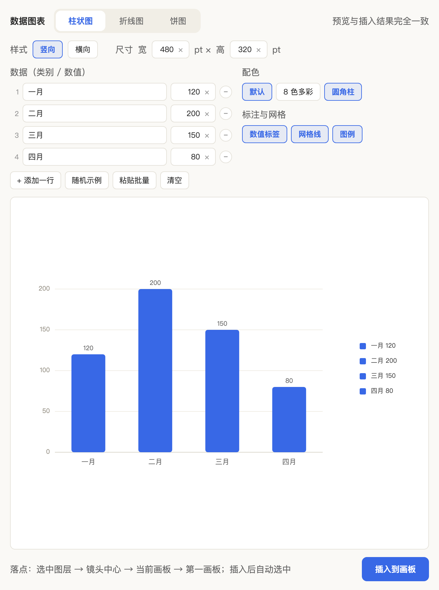
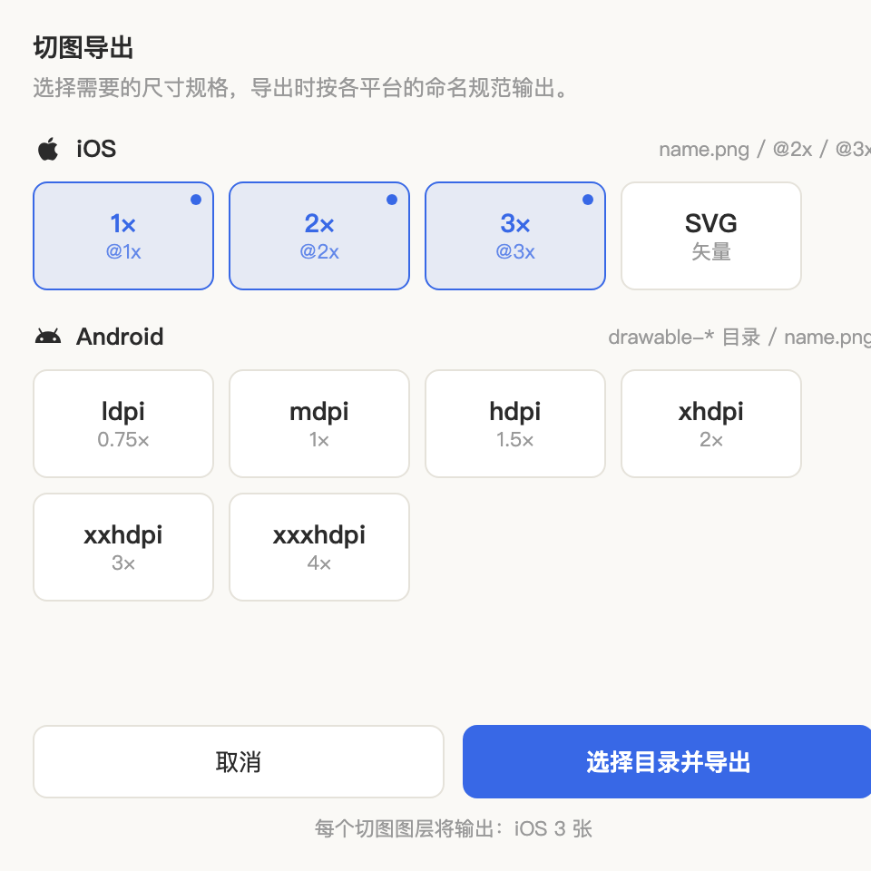
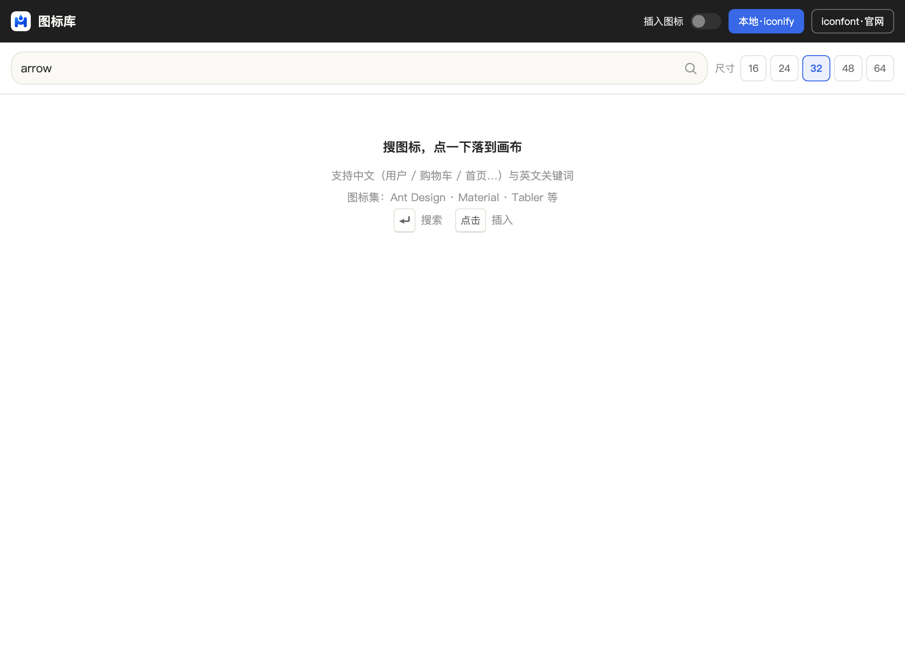

<div align="center">
  

  # 墨斗 · Inkline

  **Sketch 标注 / 交付 / 素材插件 —— 在设计稿上「弹墨线」**

  [](https://github.com/cxf825/inkline/releases)
  [](LICENSE)
  
  

  简体中文 ｜ [English](README_EN.md)

  
</div>

---

## 为什么做这个

Kitchen 与 Sketch Measure 两款经典插件已不再支持新版 Sketch，标注、切图、尺寸查看等交付能力无处安放。**墨斗·Inkline** 复刻并优化了这两款插件的核心能力，为 Sketch 用户提供一个持续维护的替代方案：

- 🖊 **交付四件套**：宽高/间距标注、注释便签、切图导出、离线 HTML 规范
- 📊 **数据图表**：柱状 / 折线 / 饼图一键插入，落进画布是**可编辑的矢量图层组**
- 🔌 **全离线**：不依赖服务端，数据只存本地，可放心用于商业项目

> 💡 本插件的**全部代码与界面均由 [WorkBuddy](https://www.workbuddy.cn) 开发完成** —— 从功能设计、代码实现、UI 打磨到构建发版，全程 AI 协作。

## 安装

1. 从 [**Releases**](https://github.com/cxf825/inkline/releases) 下载最新的 `inkline-vX.Y.Z.sketchplugin.zip` 并解压
2. 双击 `inkline.sketchplugin`（装过旧版 Kitchen3 / Inkline 请先在插件管理里卸载）
3. 重启 Sketch，菜单栏出现 `Plugins → 墨斗·Inkline`

打开插件：菜单 `Plugins → 墨斗·Inkline → 打开 / 关闭工具栏`，或快捷键 **⌃⌘B**。

---

## 功能一览

### 悬浮工具栏

Sketch Measure 式横向悬浮条，常驻画布上方、自动跟随 Sketch 窗口显隐。按住 Logo 拖动位置；「文本 / 图片 / 色板 / 分割 / 设置」向下展开抽屉，高度按内容自适应。

### 尺寸与间距标注

选中图层一键标注，自动生成带 `INK-` 前缀的标注图层，统一 10pt 字号与红 / 蓝 / 紫三色体系，随时可一键清除。

| 功能 | 说明 | 快捷键 |
|---|---|---|
| 标注宽度 | 标注图层宽度 | ⌃⇧2 |
| 标注高度 | 标注图层高度 | ⌃⇧6 |
| 标注间距 | 单选标注到画板四边距离；多选标注两两间距 | ⌃⇧3 |
| 标注属性 | 标注字号 / 行高 / 颜色等文本属性 | ⌃⇧4 |
| 注释便签 | 带编号的实现说明便签 | ⌃⌥N |
| 清除全部标注 | 清空当前页所有标注图层 | ⌃⇧5 |

### 数据图表（⌃⌥C）

<div align="center">
  
</div>

填数据 → 实时预览 → 一键插入画布。支持**柱状图**（竖向 / 横向）、**折线图**、**饼图 / 环形图**。

- 输入尺寸即**图形本体**：柱 / 折线输宽高，饼图输直径，环形输环宽（0 = 实心），描边固定白色 0–8pt
- 图例固定右侧 40pt，插入后**图例与数据图各自独立编组**，可整组拖动 / 删除
- 配色：品牌蓝单色（默认）或 8 色多彩；圆角柱、数值标签、网格线均可开关
- 数据支持手工填表、随机示例、批量粘贴 `类别,数值`
- 插入的是真矢量 + 原生文本图层，颜色文字在 Sketch 里继续改；预览与插入结果完全一致

### 切图导出（⌃⌥E）

<div align="center">
  
</div>

选中图层弹出**规格选择窗口**，勾选平台与倍率，一键导出到目录（记忆上次选择）：

- **iOS**：@1x / @2x / @3x 标准命名 + SVG 矢量
- **Android**：ldpi 0.75× ~ xxxhdpi 4×（自动输出到 `drawable-*` 目录，文件名统一 `name.png`）
- 多选同编组图层时自动按编组名建子文件夹

### 图标库（⌃⌥I）

<div align="center">
  
</div>

双模式图标窗口：

- **本地模式**：内置 Iconify 全量图标搜索（Ant Design / Material / Tabler 等），支持**中文关键词**搜索，网格墙浏览、点击即插入
- **官网模式**：内嵌 iconfont.cn，登录态原生保留，官网收藏 / 我的项目照常使用

插入后自动选中图标并把镜头定位过去，不会「找不到插到哪了」。

### 离线规范导出（⌃⇧E）

一键把当前页导出为**单文件离线 HTML 规范文档**：画板预览 + 标注叠加层 + 自动收集的颜色 / 字体规范。纯静态单文件，双击即看，直接丢给开发。

### Mock 数据填充

- **Mock 文本**（⌃⌥T）：按图层名智能匹配类型——「手机 / 邮箱 / 价格 / 姓名 / 日期」自动填对应假数据
- **Mock 图片**（⌃⌥M）：随机图片填充，支持指定本地图片目录循环使用
- **自定义词库**：独立窗口编辑，持久化保存；数据全部本地生成

### 其他

- **图形分割**：按 行 × 列 − 间距 − 页边距 把图形切成等分网格（九宫格 / 列表占位神器）
- **色板**：自动扫描文档用色（按频次排序）+ 个人收藏色板，点一下复制色值
- **一键解锁**（⌃⇧L）：解锁当前页全部锁定图层，含编组深层嵌套

## 快捷键总表

| 功能 | 快捷键 |
|---|---|
| 打开 / 关闭工具栏 | ⌃⌘B |
| 标注宽度 / 高度 / 间距 / 属性 | ⌃⇧2 / ⌃⇧6 / ⌃⇧3 / ⌃⇧4 |
| 清除全部标注 | ⌃⇧5 |
| 解锁全部锁定图层 | ⌃⇧L |
| 注释便签 | ⌃⌥N |
| 导出离线规范 | ⌃⇧E |
| 切图导出 | ⌃⌥E |
| 插入数据图表 | ⌃⌥C |
| 图标库 | ⌃⌥I |
| Mock 文本 / 图片 | ⌃⌥T / ⌃⌥M |

## 更新日志

完整版本历史见 [Releases](https://github.com/cxf825/inkline/releases)。

- **v0.5.22**：图例字号 10pt；插入后图例独立编组；切图 Android 移除重复 SVG；插件包瘦身 2.5MB → 1.1MB
- **v0.5.21**：图表画布留白按文字实测收紧，两边紧贴数字与文字
- **v0.5.17–20**：尺寸语义重做（输入 = 图形本体）、输入框统一 + 内嵌清空钮、工具栏宽度自适应 + 关闭按钮
- **v0.5.13**：新增**数据图表**（柱状 / 折线 / 饼图，实时预览，插入可编辑矢量图层）
- **v0.5.12**：全新 Logo；插件更名「墨斗·Inkline」
- **v0.5.10–11**：主色统一品牌蓝；标注带 pt 单位；切图规格弹窗

## 开发

```bash
git clone https://github.com/cxf825/inkline.git
cd inkline
npm install
NODE_OPTIONS=--openssl-legacy-provider npm run build   # 构建 → inkline.sketchplugin
NODE_OPTIONS=--openssl-legacy-provider npm run watch   # 开发时增量构建
```

版本号规则：`X.Y.Z`，小更新滚最后一位，大功能升第二位，正式版升第一位。设计规范见 [docs/设计规范.md](docs/设计规范.md)（[可视化版](docs/design-spec.html)）。

## License

[MIT](LICENSE) © cxf825
